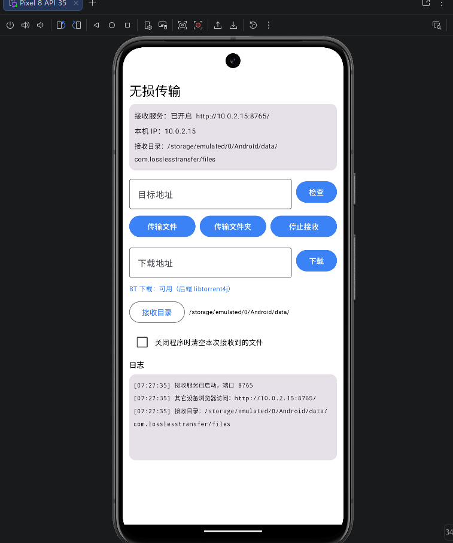

# 无损传输 (LosslessTransfer)

同一网络下，手机与电脑互传文件，支持 HTTP 上传下载与 BT 下载，原文件直传，不压缩不中转。

## 功能

- 📁 **文件 / 文件夹互传** — 手机传电脑、电脑传手机、手机传手机，保留完整目录结构
- 🌐 **内置 HTTP 接收服务** — 其他设备用浏览器打开 `http://手机IP:8765/` 即可上传下载
- ⬇️ **HTTP 下载** — 支持任意 HTTP/HTTPS 链接，自动识别文件名，实时显示进度与速度
- 🧲 **BT 下载** — 支持 magnet 磁力链、本地 `.torrent` 种子、远程种子链接
- 🔌 **USB 网络共享适配** — 手机开启 USB 网络共享后与电脑形成局域网，用法相同
- 📂 **自定义接收目录** — 位置可自由选择并自动记忆
- 🧹 **退出自动清理** — 可选，关闭 App 时自动删除本次接收的文件

## 截图



## 下载

- **Android**：从 [Releases](../../releases) 页面下载 `app-release.apk`
- **Windows**：从 [Releases](../../releases) 页面下载 `LosslessTransfer-Windows-vX.X.X.zip`，解压后运行 `无损传输.exe`

## 编译

### 环境要求

- Android Studio Ladybug (2024.2) 或更新
- JDK 17
- Android SDK 34

### 步骤

1. Clone 本仓库
   ```bash
<<<<<<< HEAD
   git clone https://github.com/XiaoCXY518/lossless-transfer.git
=======
   git clone https://github.com/XiaoCXY518/lossless-transfer.git
>>>>>>> 0488963 (添加主界面截图)
